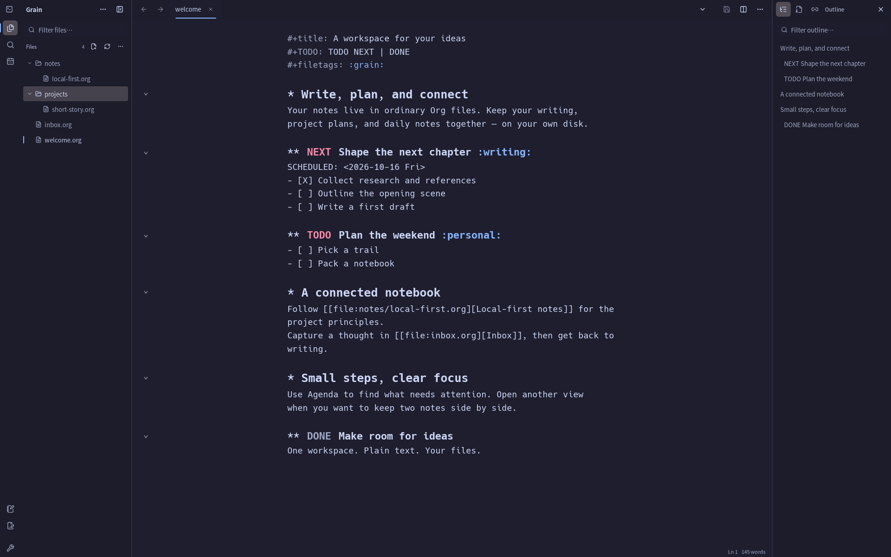

# Grain

**用本地 Org 文件，把笔记、写作与任务放在一起。**

Grain 是一个本地优先的桌面工作台，将写作、笔记链接和任务安排整合在同一个界面中。直接使用你选择的本地目录和 `.org` 文件，保存后的文档仍可在其他编辑器中阅读和修改。

[English](./README.md) · [下载发行版](https://github.com/jeasoncc/grain/releases) · [桌面端指南](./apps/desktop/README.md) · [文档目录](./docs/README.md) · [反馈问题](https://github.com/jeasoncc/grain/issues)



*Linux 桌面版 · Catppuccin Mocha 主题 · 独立示例工作区，不含个人数据。*

> **开发状态：** 本文描述当前基于 Org 的源码，较早的发行版可能仍使用旧 SQLite/Lexical 应用。**Linux 和 Windows 已有原生 Org 保存、移动与删除后端，Windows 验证使用 NTFS。** macOS 修改操作仍不支持并直接拒绝。存在某平台的安装包不等于文件系统或断电恢复语义已经等价。

[核心功能](#可以用它做什么) · [开始使用](#开始使用) · [配置方式](#文件配置) · [数据与安全](#文件与数据归属) · [本地开发](#本地开发)

## 可以用它做什么

| 工作流 | 功能 |
| --- | --- |
| 写作与整理 | 用 CodeMirror 6 编辑 Org 原文：标题、折叠、列表、复选框、标签、属性与时间戳 |
| 安排任务 | 设置计划日期与截止日期，配置 TODO 流程，创建命名 Agenda 日程视图 |
| 快速记录 | 将笔记和 TODO 收集到指定文件、标题或日期树；每次新建独立且带 ID 的日记条目 |
| 连接笔记 | `file:`、`id:`、`CUSTOM_ID` 跳转与反向链接；Org-roam 节点查找；Org-remark 高亮与边注 |
| 保持上下文 | 模糊查找、标签页、buffer 切换、分栏编辑、独立窗口，以及大纲 / 属性 / 反向链接面板 |
| 使用 Org 工具 | 子树迁移与归档、任务计时、受支持的 Org 表格操作、HTML/Markdown 导出、自定义快捷键和可选 Vim 编辑 |

同一笔记可以在多个视图中打开：正文和撤销历史共享，选区、折叠与滚动位置各自独立。切换笔记会保留未保存的修改。

Grain 实现的是一组受支持的 Org 工作流，不是 Emacs 运行时，也不承诺完整替代 GNU Org mode 及其扩展。

## 开始使用

从 [GitHub Releases](https://github.com/jeasoncc/grain/releases) 下载对应操作系统和架构的安装包。请先核对版本：旧安装包不一定包含当前 Org 工作区。要运行当前源码，请按[本地开发](#本地开发)步骤启动。

Linux 的独立 Snap 版名为 **Org Notes（`org-notes`）**。其实际频道和版本需按 [Linux 安装指南](./docs/linux-installation-guide.md) 单独核对，不会自动升级旧 Novel Editor Snap，也不会自动导入旧作品。

在原生桌面应用中：

1. **打开工作区。** 点击 **Open Documents/Grain** 使用默认目录，或通过 **Choose another…** 授权一个已有本地目录。
2. **打开或创建笔记。** 从文件树选择 `.org` 文件，或点击 **New Org document**，在底部输入栏填写 `inbox.org` 这样的相对路径。
3. **查找操作。** 按 `Alt-X` 打开 **Execute command**，搜索 **Open agenda**、**Quick capture**、**New diary entry** 或 **Org-roam: find node**。

可以先创建一个简单的 `inbox.org`：

```org
#+title: Inbox
#+TODO: TODO NEXT | DONE

* TODO 起草下一章 :writing:
- [ ] 整理素材
- [ ] 完成初稿

* 笔记
正文保持为普通文本。
```

### Linux 默认快捷键

| 快捷键 | 操作 |
| --- | --- |
| `Ctrl-O` | 快速打开文件 |
| `Alt-X`、`Ctrl-P` 或 `Ctrl-K` | 执行命令 |
| `Ctrl-S` | 保存当前笔记 |
| `Ctrl-Shift-S` | 保存所有已修改 buffer |
| `Ctrl-Shift-B` | 切换已打开的 buffer |
| 标题上的 `Tab` / `Shift-Tab` | 折叠子树 / 切换全文折叠状态 |
| `Ctrl-C Ctrl-T` | 切换标题的 TODO 状态 |
| `Ctrl-C Ctrl-O` | 跟随光标处的 Org 链接 |

`Ctrl-C Ctrl-T` 表示先按 `Ctrl-C`，再按 `Ctrl-T`。快捷键和可选 Vim 模式在 `config.json` → `keymaps` 中配置。完整说明见桌面端指南中的[编辑快捷键](./apps/desktop/README.md#org-editing-keys)和[文件树导航与操作](./apps/desktop/README.md#file-tree)。

## 文件配置

Grain 通过 `config.json` 配置，不提供图形化偏好设置页。在 **Execute command** 中执行 **Open configuration file**，用系统编辑器修改并保存文件，再执行 **Reload configuration**。

普通非 Snap Linux 包的配置路径为 `$XDG_CONFIG_HOME/com.lotus.grain/config.json`；未设置 `XDG_CONFIG_HOME` 时为 `~/.config/com.lotus.grain/config.json`。Org Notes Snap 使用独立数据空间，请通过 **Open configuration file** 查看实际位置。可配置主题、字体、自动保存（`saving`）、Capture、快捷键、Org 行为、Agenda 视图、工具位置和图表服务。缺失字段使用默认值；无效重载会被整份拒绝，不会丢弃已打开的正文和撤销历史。

参见[配置示例与安全规则](./apps/desktop/README.md#file-configuration)和[主题指南](./docs/desktop/THEMES_GUIDE.md)。内置 811 套离线 [iTerm2-Color-Schemes](https://github.com/mbadolato/iTerm2-Color-Schemes) 配色。

## 文件与数据归属

默认 workspace 位于系统 Documents 目录下的 `Grain`，也可以使用另一个明确授权的目录。

```text
Documents/Grain/            已保存的用户内容
├── inbox.org
└── projects/
    └── book.org

应用数据目录/
├── grain-org-index.db     Org 派生索引，可从 workspace 文件重建
└── grain.db               可能存在的历史数据库，不是可随意删除的缓存
```

SQLite 只保存可重建的索引，不承载 Org 正文。已打开的笔记和撤销历史保存在内存中；Agenda 和反向链接会包含未保存的修改。自动保存在 `config.json` 的 `saving` 中配置，也可以手动保存当前笔记或全部修改。

### 文件安全与当前限制

- 本地文件访问通过 Tauri/Rust 完成，限制在用户授权的目录内；浏览器预览没有这项权限。
- 路径会检查目录穿越与符号链接越界。保存、移动和删除检查预期文件 revision；遇到过期或不明确的状态时需要核对，不会静默替换。
- Linux 的描述符绑定监听与活动文档轮询保护未保存内容；Windows 当前使用活动文档轮询和手动刷新，不提供文件系统监听。跨文件 Refile/Archive 先复制并验证目标，再移除来源。
- 保存或删除可能保留 `.grain-*.tmp` 文件系统恢复产物，可通过 **Workspace tools → Recovery files…** 查看路径。它们可被外部写入修改，**不是不可变备份**，不会自动恢复或清理；不要直接批量删除。请另外备份 workspace。
- 普通笔记的未保存 buffer **尚不支持通用重启恢复**。Capture 草稿恢复是独立的显式选项，会将明文草稿保存在本地存储中，不会自动写入 Org 文件。
- 原生文件操作依赖受支持的 Linux 或 Windows 文件系统原语。Windows 拒绝 reparse/junction/符号链接和 EFS 加密 workspace 对象，避免替换或派生副本丢失加密；不支持的条件直接拒绝。选择已发布版本前先阅读 [Windows 安装边界](./docs/windows-install-guide.md)。

具体规则与恢复边界见[桌面端指南](./apps/desktop/README.md#file-mutation-rules)。

### 旧 SQLite 数据

历史 `grain.db` 可能仍保存尚未迁移作品的唯一副本，**绝不能把它当作 Org 派生索引删除**。普通 Org 启动不会打开这个历史数据库。

旧 `/legacy` 编辑器与桌面 Lexical 正文写入路径已经移除。历史数据通过 `/history` 只读查看，查看与迁移工具需要在受支持平台上以 `GRAIN_TAURI_LEGACY_MODE=1` 明确启动原生恢复环境。Windows 历史 SQLite 恢复/迁移仍不支持；本次 Org 文件后端不会迁移旧作品。仅操作经过明确授权的隔离数据库副本。使用恢复工具前，请阅读 [SQLite 启动模式说明](./apps/desktop/README.md#sqlite-startup-modes)。

## 本地开发

### 环境要求

- **Bun ≥ 1.4.2**；仓库包管理器固定为 `bun@1.4.2`。
- **Node.js** 满足 `^22.22.2 || ^24.15.0 || >=26.0.0`。
- **Rust ≥ 1.94.0** 与 Cargo。
- [Tauri 2 系统依赖](https://v2.tauri.app/start/prerequisites/)；Linux 需要 WebKitGTK 4.1 开发库。

检出仓库后，在仓库根目录安装 JavaScript 依赖，再启动桌面应用：

```bash
bun install --frozen-lockfile
cd apps/desktop
bun run tauri dev
```

JavaScript workspace 共用根目录的 `bun.lock`，使用隔离依赖链接。不要单独安装一套桌面端依赖。独立实验 `experiments/doom-runtime` 保留自己的 npm 锁文件。

Tauri 会启动 `http://localhost:1420` 上的 Vite 服务，供 WebView 使用。根目录的 **`bun run dev` 只启动桌面 Vite 服务**，不启动原生应用或 API 服务；**`bun run dev:all`** 才会启动更大的 monorepo 开发栈。这两种浏览器预览都不能获得原生 Org 文件权限；本地桌面 workspace 不需要另起 HTTP API 服务。

### 检查与构建

以下命令在 `apps/desktop` 中运行：

| 命令 | 用途 |
| --- | --- |
| `bun run type:check` | 检查 TypeScript，不生成文件 |
| `bun run test` | 运行桌面端 Vitest 测试 |
| `bun run build` | 检查 TypeScript 并构建生产前端 |
| `bun run tauri build` | 构建原生安装包，同时执行前端构建 |

共享 Rust 库测试在仓库根目录运行：

```bash
cargo test --manifest-path packages/rust-core/Cargo.toml --lib
```

Org 定向验证、原生架构与打包说明见 [Grain Desktop](./apps/desktop/README.md)。

## 仓库结构

| 路径 | 职责 |
| --- | --- |
| `apps/desktop/` | React/TypeScript 桌面 UI 与 Tauri shell |
| `packages/rust-core/` | 目录授权文件系统、索引、迁移与 Tauri commands |
| `packages/editor-*/` | 编辑器包；存在某个包不代表桌面端正在使用它 |
| `apps/web/`、`apps/admin/`、`apps/api/`、`apps/api-rust/` | 其他 monorepo 应用，与本地 Org 桌面主路径分开 |
| `docs/` | 开发、架构、部署与发布文档 |

桌面端架构与贡献边界见 [Grain Desktop](./apps/desktop/README.md)。新增文档功能应进入 Org 工作区，保留原文，并通过原生 IO 访问文件系统。

## 文档与许可证

从[桌面端指南](./apps/desktop/README.md)和[文档目录](./docs/README.md)开始；数据处理说明见[隐私政策（含中文说明）](./README.md#privacy-policy)。部分旧文档描述原 Novel Editor / SQLite/Lexical 产品，不应作为当前 Org 工作区的功能约定。

Grain 使用 [MIT 许可证](./LICENSE)。
